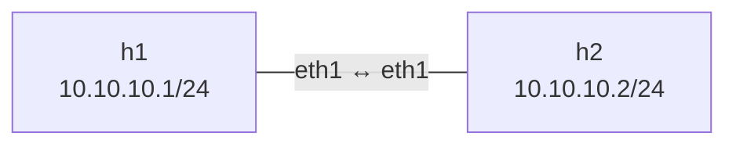
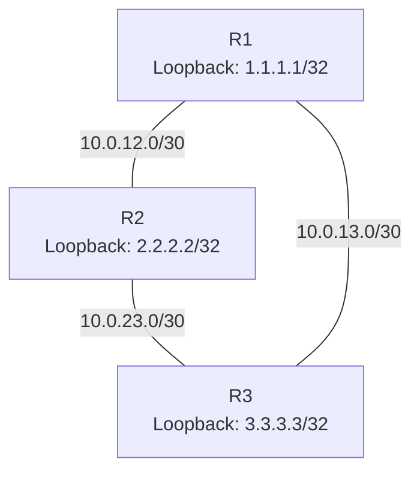
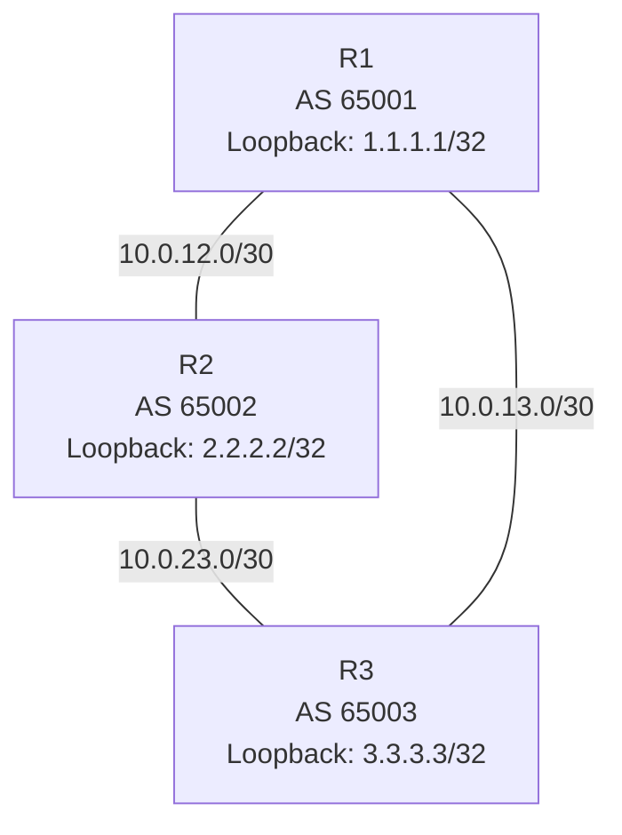

# Network Lab Topologies

This document describes the three Containerlab labs used by the network-validation project.

## Lab 1 — Basic IP connectivity

**Topology file:** `topology/first-lab.clab.yml`

- Two Linux containers connected by one Ethernet link.
- IP addresses are assigned manually during lab setup.
- Used for basic reachability and failure-detection tests.

## Lab 2 — OSPF triangle

**Topology file:** `topology/ospf-lab.clab.yml`

- Three FRRouting routers running OSPF.
- Three point-to-point links provide a direct path and an alternate path.
- The R1-to-R3 direct link can be taken down to validate route recalculation.
- Expected behavior: R1 learns an alternate route to R3 through R2 after direct-link failure.

## Lab 3 — eBGP triangle and failover

**Topology file:** `topology/bgp-lab.clab.yml`

- Three FRRouting routers in separate autonomous systems.
- R1 has BGP neighbors on its links to R2 and R3.
- R1 learns the R3 loopback route, with the direct R1–R3 path preferred in the baseline test.
- The test takes down R1's direct-link interface, checks for the route through R2, and verifies reachability.
- After the interface is restored, the test checks that the preferred direct route returns.

## Validation scope

| Lab | Main validation |
|---|---|
| Basic connectivity | IP reachability and failure detection |
| OSPF | Adjacencies, route installation, alternate-path convergence |
| BGP | Neighbor state, prefix learning, failover, route restoration, probe behavior |

## Important notes

- Interface names and subnet labels represent the configured lab links.
- The diagrams are logical views; they do not show every container interface detail or routing-policy statement.
- Link-failure and recovery measurements are specific to the software lab environment.
